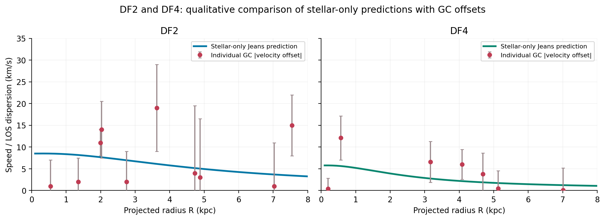

# Probing Dark Matter in Ultra-Diffuse Galaxies Using Velocity Dispersion

**Newtonian spherical Jeans modelling | Computational astrophysics | B.Tech Physics, IIT Guwahati (2026)**

[](https://www.python.org/)


This project investigates whether the observed motions of stars and globular clusters in **NGC1052-DF2**, **NGC1052-DF4**, and **Dragonfly 44 (DF44)** can be explained by their stellar mass alone, or whether an additional gravitating component is required within a Newtonian framework.

**Author:** Shivasheesh  
**Supervisors:** Dr. Sovan Chakraborty and Dr. Sayan Chakrabarti  
**Department:** Physics, Indian Institute of Technology Guwahati

The work reproduces selected **Newtonian** calculations motivated by Bhatia, Chakrabarti & Chakraborty (2023, 2025) and performs simplified independent NFW fits to published DF44 stellar kinematics. It does not reproduce the full inference pipelines or the modified-gravity models of the source papers.

## Project deliverables

| Resource | Description |
| --- | --- |
| [**Combined notebook**](notebooks/UDG_Combined_Notebook.ipynb) | Complete analysis, numerical calculations, fitting, sensitivity tests and plots |
| [Walkthrough notebook](notebooks/UDG_Analysis_Walkthrough.ipynb) | Short, annotated introduction to the workflow |
| [Numerical Jeans solver](src/udg_jeans.py) | Reusable stellar/halo mass and LOS-dispersion functions |
| [Analysis runner](src/run_analysis.py) | Standalone script for reproducing results and figures |
| [Final project report](report/BTP_Report.pdf) | Public, unsigned report PDF |
| [LaTeX report source](report/main.tex) | Source code for the report |
| [Final presentation](presentation/BTP_1_Presentation.pptx) | Main presentation and backup slides |

**The combined notebook is included in this repository.** It was adapted from the final `btp-1-ultra-diffuse-galaxies.ipynb` for relative repository paths. The walkthrough is a separate supplementary notebook, not a replacement for the complete analysis.

## Research overview

Ultra-diffuse galaxies (UDGs) have low surface brightness despite relatively large sizes. Their visible stellar content is not necessarily a reliable indicator of their total gravitational mass.

| Galaxy | Observational tracer | Question investigated |
| --- | --- | --- |
| **NGC1052-DF2** | Individual globular-cluster (GC) line-of-sight velocities | Are stellar-only Newtonian predictions compatible with the selected velocities? |
| **NGC1052-DF4** | Individual GC line-of-sight velocities | Does the same stellar-only treatment produce a plausible velocity scale? |
| **Dragonfly 44** | Nine spatially resolved stellar-dispersion measurements | Can stellar matter explain the observed dispersions, or does an NFW halo improve the fit? |

**Interpretation note:** An individual GC velocity offset is **not** a local velocity-dispersion measurement. The DF2/DF4 comparisons are qualitative checks rather than formal fits to spatially resolved dispersion profiles.

## Methodology

The numerical workflow is:

```text
Observed stellar-light distribution / adopted tracer density
                         |
                         v
             Three-dimensional density model
                         |
                         v
             Enclosed gravitating mass M(r)
                         |
                         v
          Spherical Jeans equation -> sigma_r(r)
                         |
                         v
           Line-of-sight projection -> sigma_LOS(R)
                         |
                         v
       Compare with observations; fit NFW halo for DF44
```

### 1. Spherical Jeans equation

For a steady-state, spherical, nonrotating, collisionless tracer population with constant velocity anisotropy, we solve:

```math
\frac{d}{dr}\left[\nu(r)\sigma_r^2(r)\right]
+\frac{2\beta}{r}\nu(r)\sigma_r^2(r)
=-\nu(r)\frac{G\,M(r)}{r^2}.
```

Here:

- `nu(r)` is the three-dimensional **kinematic-tracer density** (it describes the objects whose motions are observed).
- `M(r)` is the **total gravitating mass enclosed within radius r**, including stellar mass and any assumed dark halo.
- `sigma_r(r)` is the radial velocity dispersion.
- `beta` describes the preferred direction of random stellar motion.

```math
\beta=1-\frac{\sigma_{\theta}^2+\sigma_{\phi}^2}{2\sigma_r^2}.
```

The cases `beta = 0`, `beta > 0`, and `beta < 0` describe isotropic, radially biased, and tangentially biased random motions, respectively.

### 2. Line-of-sight projection

The Jeans equation predicts a **three-dimensional radial** dispersion. For comparison with spectroscopy, we project it along the observer's line of sight:

```math
\sigma_{\mathrm{LOS}}^2(R)=
\frac{2}{I(R)}\int_R^{\infty}
\left(1-\beta\frac{R^2}{r^2}\right)
\frac{\nu(r)\sigma_r^2(r)\,r}{\sqrt{r^2-R^2}}\,dr.
```

Here `R` is the projected radius on the sky, `r` is the three-dimensional radius, and `I(R)` is the projected tracer surface density. The implementation evaluates an equivalent integral over line-of-sight depth for numerical convenience.

### 3. Stellar-density models

For **DF2 and DF4**, the adopted compact, three-dimensional stellar-density law is:

```math
\rho_{\star}(r)=\frac{40\rho_0}{63a_{\star}}
\exp\left[-\left(\frac{11r}{10a_{\star}}\right)^{4/3}\right].
```

The baseline calculations assume isotropy (`beta = 0`). The adopted scale radii are 2 kpc for DF2 and 1 kpc for DF4.

For **DF44**, the stellar tracer follows an approximate deprojection of a Sérsic profile:

```math
j(r)=j_0\left(\frac{r}{a_s}\right)^{-p_n}
\exp\left[-\left(\frac{r}{a_s}\right)^{1/n}\right].
```

We use Sérsic index `n = 0.94`, projected effective radius `Re = 4.7 kpc`, and total luminosity `2.33 x 10^8` solar luminosities. The baseline stellar mass-to-light ratio is 1 in solar units.

### 4. NFW dark-matter halo

For DF44 we additionally test the **Navarro-Frenk-White (NFW)** halo:

```math
\rho_{\mathrm{NFW}}(r)=
\frac{\rho_s}{(r/r_s)(1+r/r_s)^2}.
```

We parameterize it by halo mass `M200` (the mass within `r200`) and concentration `c = r200 / rs`. The gravitating mass entering Jeans modelling is the sum of stellar and dark-halo enclosed mass. **Adding a halo changes the gravitational mass profile, not the assumed stellar tracer profile.**

Two principal fits are compared:

- **Fixed concentration:** set `c = 10` and optimize `M200` and `beta`.
- **Free concentration:** optimize `M200`, `beta` and `c` with the imposed constraint `2 <= c <= 40`.

### 5. Numerical fitting

Enclosed-mass and Jeans integrals are evaluated numerically. The DF44 fit uses **bounded nonlinear least squares** in SciPy and accounts for **asymmetric observational uncertainties**: the upper error is used when the model prediction exceeds the observed value, and the lower error when the model falls below it. Nine measurements are treated as independent.

## Results

### Stellar-only Newtonian predictions

The computed line-of-sight dispersions at a projected radius of **1 kpc** are:

| Galaxy / model | Anisotropy `beta` | Stellar mass (solar masses) | LOS dispersion (km/s) |
| --- | ---: | ---: | ---: |
| DF2 | 0 | 2.547 x 10^8 | **8.36** |
| DF4 | 0 | 5.858 x 10^7 | **5.20** |
| DF44, isotropic | 0 | 2.330 x 10^8 | **5.47** |
| DF44, tangential | -0.6 | 2.330 x 10^8 | **4.48** |
| DF44, radial *(formal example only)* | +0.6 | 2.330 x 10^8 | **7.23** |

The nine observed DF44 stellar dispersions are approximately **26-40 km/s**. All three tested stellar-only predictions are far below those measurements. The `beta = +0.6` DF44 curve is a *formal Jeans solution* that violates a necessary central phase-space consistency condition for the adopted tracer approximation; it is not presented as a physically admissible DF44 model.




### DF44 NFW halo fits

| Scenario | Halo mass `M200` (solar masses) | Concentration `c` | Anisotropy `beta` | Chi-squared | Reduced chi-squared |
| --- | ---: | ---: | ---: | ---: | ---: |
| **Fixed concentration** | 3.57 x 10^10 | 10 (fixed) | -0.6475 | **4.00** | 0.571 |
| **Free concentration** | 1.20 x 10^12 | 2 (lower bound) | -0.2668 | **2.92** | 0.487 |


The two fitted halos have very different extrapolated `M200` values, yet each encloses approximately **4.2 x 10^9 solar masses of dark matter within 6.3 kpc**. This illustrates the **halo mass-concentration-anisotropy degeneracy**: the measured stars more directly probe their local mass distribution than the outer halo.

The free-concentration solution reaches the **lower imposed bound `c = 2`**. This is **not a measurement** of the galaxy's true concentration, and its modest chi-squared improvement does not establish a unique halo model.


The combined notebook also contains a **stellar mass-to-light-ratio sensitivity fit**. Under the adopted constraints, its best value reaches the imposed lower bound, with little improvement in goodness of fit; the dynamical observations do not independently determine this stellar-population parameter in this model.

## Reproducing the analysis

**Requirements:** Python 3.10+ and the packages listed in [`requirements.txt`](requirements.txt).

From the repository root:

```bash
python -m pip install -r requirements.txt
python -m src.run_analysis
```

This regenerates the main summary CSVs in [`results/`](results/) and plots in [`figures/`](figures/).

To run the comprehensive notebook:

```bash
jupyter lab
```

Open **[`notebooks/UDG_Combined_Notebook.ipynb`](notebooks/UDG_Combined_Notebook.ipynb)** and select **Run All Cells**. Launch Jupyter from the repository root; the notebook uses relative paths to the three CSV datasets. The separate [walkthrough notebook](notebooks/UDG_Analysis_Walkthrough.ipynb) explains the reusable functions in `src/`.

## Repository layout

```text
.
|-- README.md
|-- requirements.txt
|-- .gitignore
|-- data/                   # observational CSV files and provenance notes
|-- src/                    # reusable Jeans solver and analysis runner
|-- notebooks/
|   |-- UDG_Combined_Notebook.ipynb
|   `-- UDG_Analysis_Walkthrough.ipynb
|-- figures/                # regenerated scientific figures
|-- results/                # fit summaries and model predictions
|-- report/
|   |-- main.tex
|   `-- BTP_Report.pdf
`-- presentation/
    `-- BTP_1_Presentation.pptx
```

## Conclusions and limitations

- **DF2 and DF4:** the stellar-only predictions are compatible with the selected globular-cluster velocity scales, but this is not proof that either galaxy contains no dark matter.
- **DF44:** for the adopted mass-to-light ratio and anisotropy models, the stellar-only predictions fall well below its observed stellar dispersions; a stellar-plus-NFW model gives acceptable Newtonian fits.
- **Degeneracies:** halo mass, concentration, and velocity anisotropy are not uniquely determined by these data. The outer halo mass is especially sensitive to model assumptions.
- **Model assumptions:** spherical symmetry, equilibrium, no mean streaming, constant anisotropy, fixed tracer models, a small GC sample for DF2/DF4 and only nine stellar bins for DF44. Aperture/seeing convolution and full Bayesian uncertainty intervals are not included.

The results are **conditional on Newtonian gravity and the adopted models**. They do not rule out alternative gravity theories or other dark-matter density profiles.

## References

1. E. Bhatia, S. Chakrabarti and S. Chakraborty (2023), *Velocity dispersion of dark-matter deficient ultradiffuse galaxies: A case for modified gravity*, **Physical Review D 108**, 064021. [DOI](https://doi.org/10.1103/PhysRevD.108.064021).
2. E. Bhatia, S. Chakrabarti and S. Chakraborty (2025), *Exploring velocity dispersion anisotropy in a dark matter dominated ultra-diffuse galaxy with modified gravity models*, **Physical Review D 112**, 024034. [DOI](https://doi.org/10.1103/2k1h-fj16).
3. P. van Dokkum et al. (2019), *Spatially resolved stellar kinematics of the ultra-diffuse galaxy Dragonfly 44. I*, **The Astrophysical Journal 880**, 91. [DOI](https://doi.org/10.3847/1538-4357/ab2914).
4. P. van Dokkum et al. (2018), *A galaxy lacking dark matter*, **Nature 555**, 629-632. [DOI](https://doi.org/10.1038/nature25767).
5. P. van Dokkum et al. (2019), *A second galaxy missing dark matter in the NGC1052 group*, **The Astrophysical Journal Letters 874**, L5. [DOI](https://doi.org/10.3847/2041-8213/ab0d92).
6. J. F. Navarro, C. S. Frenk and S. D. M. White (1997), *A universal density profile from hierarchical clustering*, **The Astrophysical Journal 490**, 493-508. [DOI](https://doi.org/10.1086/304888).

## Data and attribution

The observational datasets are transcriptions/compilations from published studies; consult the cited papers and [`data/README.md`](data/README.md) for provenance and reuse considerations. The report PDF is an **unsigned public copy**. Source papers and handwritten faculty signatures are not redistributed here. No software license has been selected; reuse rights should not be assumed without one.
