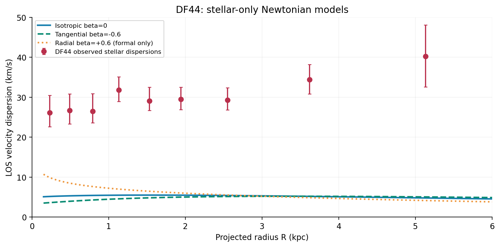
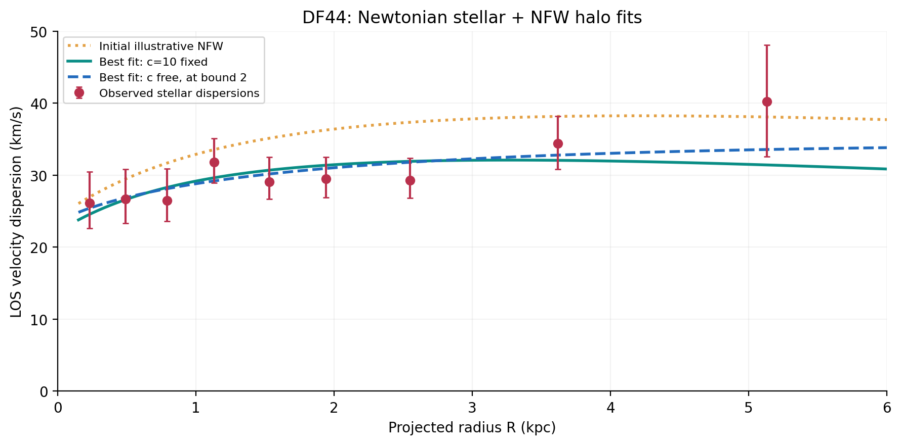
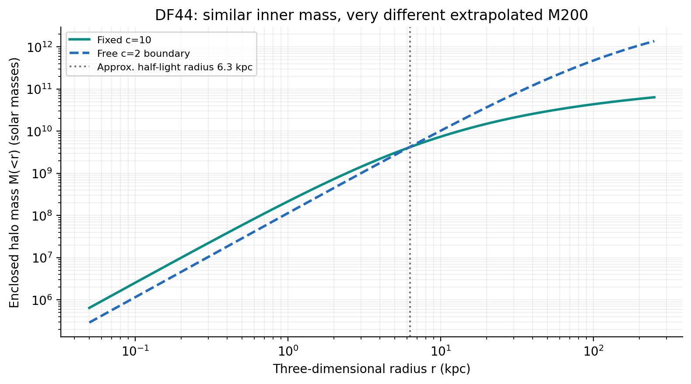

# Probing Dark Matter in Ultra-Diffuse Galaxies Using Velocity Dispersion

**A Newtonian spherical-Jeans investigation of NGC1052-DF2, NGC1052-DF4, and Dragonfly 44 (DF44).**

<p align="left">
  
  
  
  
</p>

> **Research question:** Can the observed random motions in three ultra-diffuse galaxies be explained by their visible stellar mass alone, or do Newtonian models require an additional dark-matter component?

This repository documents a B.Tech computational physics project at the **Department of Physics, Indian Institute of Technology Guwahati (2026)**, supervised by **Dr. Sovan Chakraborty** and **Dr. Sayan Chakrabarti**.

The work implements selected **Newtonian baselines** motivated by Bhatia, Chakrabarti & Chakraborty (2023, 2025), using published kinematic measurements. It is a computational replication and a simplified independent fitting exercise—not a claim to have reproduced the full inference pipelines or modified-gravity calculations of the source papers.

## Final deliverables

The latest final **presentation** and **LaTeX report source** provided for this repository are included. The public PDF is rebuilt from that source, excluding the original signed certificate and similarity-check appendix for public distribution.

- **[Public report](report/BTP_Report.pdf)** · **[LaTeX source](report/main.tex)**
- **[Final B.Tech presentation (26 slides)](presentation/BTP_1_Presentation.pptx)** — includes speaker notes and backup slides
- **[Executable walkthrough notebook](notebooks/UDG_Analysis_Walkthrough.ipynb)**
- **[Reusable numerical implementation](src/udg_jeans.py)** · **[Analysis runner](src/run_analysis.py)**

> **One file still needs to be added before publishing:** you mentioned `UDG_Combined_Notebook.ipynb`, but it was not attached along with the final report/presentation. Add your actual final file under `notebooks/`; the older walkthrough has not been relabelled as your final notebook. See [upload checklist](FINAL_UPLOAD_CHECKLIST.md).

## Overview

Ultra-diffuse galaxies (UDGs) are exceptionally faint relative to their physical sizes. Their stellar populations can be sparse even when their gravitational potentials are substantial. This makes them interesting cases for comparing luminous matter with dynamical mass.

The three galaxies studied here provide contrasting examples:

| Galaxy | Kinematic information | Question explored |
|---|---|---|
| **NGC1052-DF2** | Individual globular-cluster (GC) line-of-sight velocities | Is a stellar-only Newtonian model compatible with the selected data? |
| **NGC1052-DF4** | Individual GC line-of-sight velocities | Does the same baseline provide a plausible velocity scale? |
| **Dragonfly 44** | Nine spatially resolved stellar velocity-dispersion measurements | Can stars alone explain the dispersions, or is an NFW halo needed? |

**Crucial distinction:** An individual GC's absolute velocity offset is *not* a local velocity-dispersion measurement. The DF2/DF4 overlays are therefore **qualitative consistency checks**, not fits to a spatially resolved dispersion profile.

## Start here

- **[Full end-to-end notebook](notebooks/UDG_Combined_Notebook.ipynb)** — the author's combined analysis (adapted for portable relative file paths).
- **[Short walkthrough notebook](notebooks/UDG_Analysis_Walkthrough.ipynb)** — an annotated guide to the modular `src/` pipeline.
- **[Reusable Python solver](src/udg_jeans.py)** and **[standalone analysis script](src/run_analysis.py)** — regenerate main results with a single command.
- **[Final public project report](report/BTP_Report.pdf)** and **[final presentation](presentation/BTP_1_Presentation.pptx)** — academic deliverables.

## Physics and methodology

The analysis follows this sequence:

```text
Stellar distribution / tracer density  nu(r)
                 |
                 v
       Enclosed gravitating mass  M(<r)
                 |
                 v
     Spherical Jeans equation  -->  radial dispersion sigma_r(r)
                 |
                 v
     Line-of-sight projection  -->  sigma_LOS(R)
                 |
                 v
   Comparison with observations / DF44 halo fitting
```

### 1. Spherical Jeans modelling

For a steady-state, nonrotating, spherical collisionless tracer population with constant anisotropy:

$$
\frac{d[\nu(r)\sigma_r^2(r)]}{dr}
+\frac{2\beta}{r}\nu(r)\sigma_r^2(r)
=-\nu(r)\frac{GM(<r)}{r^2}.
$$

Here, $\nu(r)$ describes the **kinematic tracers**, while $M(<r)$ is the **total enclosed gravitating mass**. The two are not interchangeable. The anisotropy parameter is

$$
\beta=1-\frac{\sigma_\theta^2+\sigma_\phi^2}{2\sigma_r^2}.
$$

The radial variance is integrated and projected onto the observer's line of sight to obtain $\sigma_{\rm LOS}(R)$, the quantity relevant to the DF44 spectroscopy.

### 2. Stellar density models

- **DF2 and DF4:** adopt the compact stellar density law used in the 2023 reference study, assume isotropy ($\beta=0$), and use stellar mass only.
- **DF44:** adopt an approximate deprojection of a Sérsic luminosity profile, with $n=0.94$, $R_e=4.7\,\mathrm{kpc}$, $L_{\rm tot}=2.33\times10^8L_\odot$, and stellar mass-to-light ratio $\Upsilon_\star=1\,M_\odot/L_\odot$.

### 3. Dark-matter halo for DF44

The Navarro–Frenk–White (NFW) density profile is

$$
\rho_{\rm NFW}(r)=\frac{\rho_s}{(r/r_s)(1+r/r_s)^2},
$$

specified here by the halo mass $M_{200}$ and concentration $c=r_{200}/r_s$. The total mass entering the Jeans model is

$$M_{\rm total}(<r)=M_\star(<r)+M_{\rm NFW}(<r).$$

The analysis compares a **fixed-concentration fit** ($c=10$) with a **free-concentration sensitivity test** ($2\le c\le40$).

### 4. Fitting and numerical methods

- Numerical enclosed-mass and Jeans integrations using cumulative trapezoidal integration.
- Numerical line-of-sight integration in the depth coordinate $z$ to avoid the apparent singularity of the usual projected-radius integral.
- Bounded nonlinear least squares via SciPy.
- **Asymmetric observational uncertainties:** use the upper error when the model is above the observed DF44 dispersion and the lower error when below it (a piecewise-/split-Gaussian approximation).
- Nine DF44 measurements treated as independent. No cosmological concentration–mass prior, posterior confidence intervals, or aperture/seeing convolution are included.

## Results

### Stellar-only Newtonian models

| Galaxy / configuration | Assumed $\beta$ | Integrated stellar mass ($M_\odot$) | Predicted $\sigma_{\rm LOS}$ at $R=1\,$kpc (km/s) |
|---|---:|---:|---:|
| DF2 | 0 | $2.547\times10^8$ | **8.36** |
| DF4 | 0 | $5.858\times10^7$ | **5.20** |
| DF44, isotropic | 0 | $2.330\times10^8$ | **5.47** |
| DF44, tangential | $-0.6$ | $2.330\times10^8$ | **4.48** |
| DF44, radial *(formal only)* | $+0.6$ | $2.330\times10^8$ | **7.23** |

For DF44, the observed dispersions are roughly **26–40 km/s** across the nine radial bins, far above the tested stellar-only predictions. The $\beta=+0.6$ curve is retained as a mathematical illustration only: it violates the necessary central cusp-slope/anisotropy consistency condition for the adopted tracer approximation.



### DF44 NFW fits

| Fit | $M_{200}$ ($M_\odot$) | Concentration $c$ | Anisotropy $\beta$ | $\chi^2$ | Nominal reduced $\chi^2$ |
|---|---:|---:|---:|---:|---:|
| **Fixed concentration** | $3.57\times10^{10}$ | **10 (fixed)** | $-0.6475$ | **4.00** | 0.571 |
| **Free concentration** | $1.20\times10^{12}$ | **2 (lower bound)** | $-0.2668$ | **2.92** | 0.487 |



**Interpretation:** Despite a roughly 34-fold difference in extrapolated $M_{200}$, the two fits predict nearly the same NFW halo mass inside about $6.3\,\mathrm{kpc}$: $\sim4.2\times10^9\,M_\odot$. The limited radial coverage constrains the **inner mass distribution** much more directly than the halo's outer mass and concentration.

The free-$c$ solution **hits the imposed lower bound $c=2$**. It is *not* a measurement of DF44's actual concentration. Allowing one more fit parameter decreases $\chi^2$ by only about $1.08$, so the improved fit should not be overinterpreted.



## Repository structure

```text
.
├── README.md
├── FINAL_UPLOAD_CHECKLIST.md
├── requirements.txt
├── .gitignore
├── data/
│   ├── README.md
│   ├── DF2_original_GC_2018.csv
│   ├── DF4_original_GC_2019.csv
│   └── DF44_original_dispersion_2019.csv
├── src/
│   ├── __init__.py
│   ├── udg_jeans.py
│   └── run_analysis.py
├── notebooks/
│   ├── README.md
│   ├── UDG_Combined_Notebook.ipynb
│   └── UDG_Analysis_Walkthrough.ipynb
├── results/
│   ├── stellar_only_summary.csv
│   ├── df44_fit_summary.csv
│   ├── df44_fit_point_predictions.csv
│   └── df44_fit_results.json
├── figures/
│   ├── df2_df4_newtonian.png
│   ├── df44_stellar_only.png
│   ├── df44_nfw_bestfit.png
│   ├── df44_nfw_fit_residuals.png
│   └── df44_enclosed_halo_mass.png
├── report/
│   ├── README.md
│   ├── main.tex
│   └── BTP_Report.pdf
└── presentation/
    ├── README.md
    └── BTP_1_Presentation.pptx
```

## Reproduce the numerical analysis

Tested with Python 3 and NumPy, SciPy, pandas, and Matplotlib.

```bash
# Clone your repository after publishing it:
git clone https://github.com/<YOUR-USERNAME>/<YOUR-REPO>.git
cd <YOUR-REPO>

# Install dependencies:
python -m pip install -r requirements.txt

# Generate results/*.csv and figures/*.png:
python -m src.run_analysis
```

The script reads the three CSVs in `data/`, recomputes the stellar-only predictions, refits the two DF44 NFW scenarios, and regenerates the five figures above. The combined notebook also evaluates a stellar mass-to-light-ratio sensitivity fit and saves its fitted parameters in `results/df44_fit_results.json`. It does not require an internet connection. For an annotated introduction to the workflow, see `notebooks/UDG_Analysis_Walkthrough.ipynb`. The final presentation is included unchanged; no historical PowerPoint source-code directory is published.

**Main end-to-end notebook:** [UDG_Combined_Notebook.ipynb](notebooks/UDG_Combined_Notebook.ipynb) (uploaded as `btp-1-ultra-diffuse-galaxies.ipynb`). It includes the DF2/DF4 stellar-only calculations, DF44 stellar-only anisotropy examples, the illustrative NFW model, three numerical fit scenarios (fixed concentration, free concentration and variable stellar mass-to-light ratio), residual plots and a numerical convergence check. This notebook is self-contained apart from its Python package dependencies and the three observational CSVs. Its only edits for repository use are relative data/figure/result paths; the mathematical model and parameter values are unchanged.

To run it, start `jupyter lab` at the repository root and open `notebooks/UDG_Combined_Notebook.ipynb`, then choose **Run All Cells**. It looks for the CSVs in `../data/` when executed from `notebooks/` and writes selected figures to `figures/` and additional fit artifacts to `results/`.

**Short introduction:** [UDG_Analysis_Walkthrough.ipynb](notebooks/UDG_Analysis_Walkthrough.ipynb) uses the reusable library in `src/` and focuses on the pipeline. **Standalone reproducible run:** `python -m src.run_analysis` generates the main figures and CSVs without needing Jupyter.

**Numerical reproducibility:** Finite integration limits, radial grids and optimizer bounds are specified in `src/udg_jeans.py`. Very small differences may arise with library versions or numerical precision.

**Report source:** `report/main.tex` references four matching figures in the root `figures/` directory. To compile from the repository root, run `pdflatex -output-directory=report report/main.tex` twice. The included public PDF is compiled from this source; the signed original submission and similarity-check appendix are intentionally not redistributed.

## Conclusions and limitations

**Within the adopted Newtonian, spherical and equilibrium assumptions:**

1. **DF2/DF4:** The stellar-only models yield velocity scales compatible with the selected sparse GC observations. This does **not** prove an absence of dark matter; the GC velocity offsets shown are not intrinsic dispersion estimates.
2. **DF44:** Its stellar-only predictions are well below the nine published stellar dispersions for the mass-to-light ratio and anisotropies tested. Adding an NFW halo produces acceptable fits.
3. **Degeneracies:** The data do not uniquely determine $M_{200}$, $c$ and $\beta$. Inner enclosed mass is better anchored than the full halo extrapolation.
4. **Model limitations:** Spherical equilibrium, constant anisotropy, simplified tracer profiles, limited GC samples and nine DF44 bins; no full observational response model or Bayesian uncertainty analysis.

Additional mass under Newtonian gravity is **not logically equivalent to proving a specific dark-matter theory**; modified gravity, cored halos, tidal evolution and more general anisotropy require separate modelling.

## Next steps

- Fit DF2 and DF4 using the actual globular-cluster tracer distribution and an appropriate likelihood for individual GC velocities.
- Include physical aperture/seeing convolution and measure uncertainty intervals for the DF44 fit parameters.
- Explore a cosmological concentration–mass prior, alternative halo profiles and radially varying anisotropy.
- Compare with the modified-gravity prescriptions discussed in the source papers, on the same observational data.

## References and attribution

This project builds on published data and methods. **Please cite the underlying scientific studies when using the models or data**:

1. E. Bhatia, S. Chakrabarti & S. Chakraborty, *Velocity dispersion of dark-matter deficient ultradiffuse galaxies: A case for modified gravity*, **Physical Review D 108**, 064021 (2023). [DOI](https://doi.org/10.1103/PhysRevD.108.064021)
2. E. Bhatia, S. Chakrabarti & S. Chakraborty, *Exploring velocity dispersion anisotropy in a dark matter dominated ultra-diffuse galaxy with modified gravity models*, **Physical Review D 112**, 024034 (2025). [DOI](https://doi.org/10.1103/2k1h-fj16)
3. P. van Dokkum et al., *Spatially resolved stellar kinematics of the ultra-diffuse galaxy Dragonfly 44. I*, **The Astrophysical Journal 880**, 91 (2019). [DOI](https://doi.org/10.3847/1538-4357/ab2914)
4. P. van Dokkum et al., *A galaxy lacking dark matter*, **Nature 555**, 629–632 (2018). [DOI](https://doi.org/10.1038/nature25767)
5. P. van Dokkum et al., *A second galaxy missing dark matter in the NGC1052 group*, **Astrophysical Journal Letters 874**, L5 (2019). [DOI](https://doi.org/10.3847/2041-8213/ab0d92)
6. J. F. Navarro, C. S. Frenk & S. D. M. White, *A universal density profile from hierarchical clustering*, **The Astrophysical Journal 490**, 493–508 (1997). [DOI](https://doi.org/10.1086/304888)

### Usage and provenance note

The observational CSVs are research-data transcriptions/compilations used for educational replication; check the original articles and their reuse terms before redistribution. The public report is an unsigned source-compiled version to avoid sharing supervisor signatures. The project does not claim ownership of the published observations. The repository does **not** include copyrighted full-text copies of the source papers.

No software license has been selected for this repository yet. Add a `LICENSE` file only after deciding how you want others to use your code, and check any third-party material separately.
